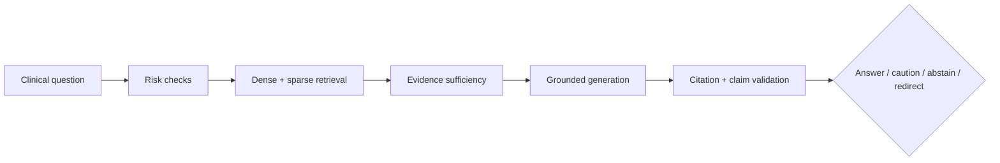

<div align="center">

<picture>
  <source media="(max-width: 640px) and (prefers-color-scheme: dark)" srcset="./assets/profile-header-mobile-dark.svg" />
  <source media="(max-width: 640px) and (prefers-color-scheme: light)" srcset="./assets/profile-header-mobile-light.svg" />
  <source media="(prefers-color-scheme: dark)" srcset="./assets/profile-header-dark.svg" />
  <source media="(prefers-color-scheme: light)" srcset="./assets/profile-header-light.svg" />
  
</picture>

<br />


### AI Engineer · Generative AI & RAG · Computer Vision & Edge AI

**I build AI systems that can explain where their answers came from, show how they were evaluated, and run beyond a notebook.**

[**Portfolio ↗**](https://adhamelsayedai.github.io/) &nbsp;·&nbsp; [**Résumé ↗**](https://adhamelsayedai.github.io/Adham_Elsayed_CV.pdf) &nbsp;·&nbsp; [**LinkedIn ↗**](https://www.linkedin.com/in/adham-elsayed-/) &nbsp;·&nbsp; [**Contact ↗**](mailto:adhamelsayed515@gmail.com)

</div>

---

## At a glance

I'm an **AI Engineering student at Mansoura University, Egypt**, building practical systems across **LLM/RAG engineering, computer vision, model evaluation, and deployment**. I work from data preparation and model behavior through APIs, interfaces, and the guardrails needed to use the system responsibly.

| What I work on | What that looks like in practice |
| :--- | :--- |
| **Generative AI / RAG** | Hybrid retrieval, embeddings, citations, evidence sufficiency, abstention and claim checks |
| **Computer Vision / Edge** | YOLO training and evaluation, OpenCV pipelines, ONNX inference, Raspberry Pi integration |
| **AI Systems Engineering** | FastAPI backends, reproducible experiments, data workflows, deployment and observability |

## Featured engineering work

### 01 — MedFlow · Evidence-Grounded Clinical RAG

<sub>GENERATIVE AI &nbsp; / &nbsp; RETRIEVAL &nbsp; / &nbsp; SAFETY ENGINEERING</sub>

<a href="https://adhamelsayedai.github.io/#projects">
  
</a>

MedFlow is a **team-built thyroid-focused clinical AI prototype**. Rather than let a language model generate without constraints, the system retrieves medical evidence, checks sufficiency, resolves citations and validates claims before choosing to **answer, caution, abstain or redirect**.

**Measured results** (internal engineering evaluations):

| Evaluation | Result | Scope |
| :--- | ---: | :--- |
| **Retrieval Hit@4** | **87.50%** | 16 ground-truth questions |
| **Mean reciprocal rank** | **0.7031** | Same frozen retrieval benchmark |
| **Citation ID validity** | **100%** | 7-case grounded generation evaluation |
| **Fabricated citations** | **0** | Same 7 evaluation cases |

**My engineering focus:** evidence retrieval, retrieval evaluation, grounding, validation and safer response behavior. The project received **2nd place at AI Hackathon Mansoura 2026** as a team achievement.

> These results measure retrieval and citation behavior on limited test sets — **not clinical accuracy**. The primary MedFlow engineering repository remains private.

**[Explore the MedFlow case study →](https://adhamelsayedai.github.io/#projects)**

<details>
<summary><b>See the RAG engineering workflow</b></summary>



The frozen 16-question retrieval benchmark and the separate 7-case grounded-generation evaluation measure different parts of the system; neither is a medical-device validation.

</details>

---

### 02 — Smart Basket · Edge AI Retail System

<sub>COMPUTER VISION &nbsp; / &nbsp; EDGE INFERENCE &nbsp; / &nbsp; PRODUCT INTEGRATION</sub>

<a href="https://github.com/AdhamElsayedAI/Smart-Basket">
  
</a>

A vision-assisted checkout prototype combining **four-class YOLO product detection**, **ONNX Runtime on Raspberry Pi 5** and basket-state synchronization through **Firebase to a Flutter mobile app**.

**Project-reported object detection:** **96.89% mAP@0.5** · **84.79% mAP@0.5:0.95**.

**Engineering path:** camera → OpenCV / YOLO → ONNX on Raspberry Pi → basket state → Firebase → Flutter.

**[Explore source code →](https://github.com/AdhamElsayedAI/Smart-Basket)**

<sub>Artwork above is a concept illustration; project metrics refer to model evaluation, not an end-to-end checkout accuracy guarantee.</sub>

---

### 03 — Code AI Proctor · Auditable Exam Monitoring

<sub>COMPUTER VISION &nbsp; / &nbsp; FASTAPI &nbsp; / &nbsp; MONITORING WORKFLOWS</sub>

<a href="https://github.com/AdhamElsayedAI/code-ai-proctor">
  
</a>

A self-hosted proctoring prototype that connects **webcam-frame classification** to configurable alerts, captured incident evidence and teacher review — within organization, teacher and student portals.

**System signals:** **2 classification classes** (cheating / normal) · **3 role-based portals** · auditable incident workflow. Built with **YOLO, PyTorch, FastAPI and optional SQL persistence**.

**[Explore source code →](https://github.com/AdhamElsayedAI/code-ai-proctor)**

<sub>Artwork above is a concept illustration. No unsupported model-accuracy or production-readiness figures are claimed.</sub>

---

## Technical toolkit

| Domain | Tools & approaches |
| :--- | :--- |
| **AI / ML** | Python · PyTorch · Ultralytics YOLO · Scikit-learn · model evaluation |
| **RAG / LLMs** | BGE · BM25 · RRF · ChromaDB · grounded generation · citation validation |
| **Computer vision / Edge** | OpenCV · ONNX Runtime · Raspberry Pi 5 |
| **Backend / Integration** | FastAPI · REST APIs · SQL · Firebase · Flutter · Docker · Git |

### How I work

```text
Understand the problem → Build a baseline → Evaluate failures
        ↓
Improve the model and evidence path → Add safety checks
        ↓
Expose an API → Integrate the product → Measure again
```

I care about **traceable decisions, honest metrics, practical deployment and useful product behavior** — not just a demo that looks convincing.

## Background & contact

**Education:** B.Sc. AI Engineering, Mansoura University *(in progress)*.  
**Location:** Egypt.  
**Interests:** Generative AI, retrieval systems, model evaluation, edge inference, AI-powered software products.

<div align="center">

**[Portfolio](https://adhamelsayedai.github.io/)** &nbsp;·&nbsp; **[GitHub](https://github.com/AdhamElsayedAI)** &nbsp;·&nbsp; **[LinkedIn](https://www.linkedin.com/in/adham-elsayed-/)** &nbsp;·&nbsp; **[Email](mailto:adhamelsayed515@gmail.com)**

<sub>Built around evidence, evaluation and engineering clarity. All project figures are tied to their stated test context.</sub>

</div>