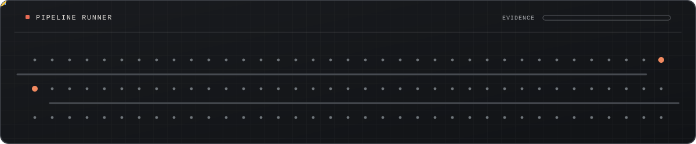

<picture>
  <source media="(max-width: 640px) and (prefers-color-scheme: dark)" srcset="./assets/hero-mobile-dark.svg" />
  <source media="(max-width: 640px) and (prefers-color-scheme: light)" srcset="./assets/hero-mobile-light.svg" />
  <source media="(prefers-color-scheme: dark)" srcset="./assets/hero-dark.svg" />
  <source media="(prefers-color-scheme: light)" srcset="./assets/hero-light.svg" />
  
</picture>

 

I’m **Adham Elsayed**, an AI Engineering student at **Mansoura University, Egypt**. I work on **generative AI, retrieval-augmented systems, computer vision, and the backend services that turn models into usable software**.

My focus is on the parts that make AI systems trustworthy in practice: the quality of the data, the evidence behind an answer, how a model is evaluated, and how the result reaches a product.

&nbsp;&nbsp;&nbsp;

<picture>
  <source media="(prefers-color-scheme: dark)" srcset="./assets/divider-dark.svg" />
  <source media="(prefers-color-scheme: light)" srcset="./assets/divider-light.svg" />
  
</picture>

### What I work on

**01 &nbsp; Grounded AI & RAG**  
Hybrid search, embeddings, reranking, evidence selection, citation grounding, and retrieval evaluation.

**02 &nbsp; Computer Vision & Edge AI**  
Detection and classification pipelines, OpenCV, ONNX inference, and deployment-oriented experiments.

**03 &nbsp; Backend engineering**  
Python and FastAPI services, data modeling, API integration, testing, and practical interfaces.

<picture>
  <source media="(prefers-color-scheme: dark)" srcset="./assets/divider-dark.svg" />
  <source media="(prefers-color-scheme: light)" srcset="./assets/divider-light.svg" />
  
</picture>

### Skills & technology

<picture>
  <source media="(max-width: 640px) and (prefers-color-scheme: dark)" srcset="./assets/skills-ai-mobile-dark.svg" />
  <source media="(max-width: 640px) and (prefers-color-scheme: light)" srcset="./assets/skills-ai-mobile-light.svg" />
  <source media="(prefers-color-scheme: dark)" srcset="./assets/skills-ai-dark.svg" />
  <source media="(prefers-color-scheme: light)" srcset="./assets/skills-ai-light.svg" />
  
</picture>

<picture>
  <source media="(max-width: 640px) and (prefers-color-scheme: dark)" srcset="./assets/skills-vision-mobile-dark.svg" />
  <source media="(max-width: 640px) and (prefers-color-scheme: light)" srcset="./assets/skills-vision-mobile-light.svg" />
  <source media="(prefers-color-scheme: dark)" srcset="./assets/skills-vision-dark.svg" />
  <source media="(prefers-color-scheme: light)" srcset="./assets/skills-vision-light.svg" />
  
</picture>

<picture>
  <source media="(max-width: 640px) and (prefers-color-scheme: dark)" srcset="./assets/skills-backend-mobile-dark.svg" />
  <source media="(max-width: 640px) and (prefers-color-scheme: light)" srcset="./assets/skills-backend-mobile-light.svg" />
  <source media="(prefers-color-scheme: dark)" srcset="./assets/skills-backend-dark.svg" />
  <source media="(prefers-color-scheme: light)" srcset="./assets/skills-backend-light.svg" />
  
</picture>

<picture>
  <source media="(prefers-color-scheme: dark)" srcset="./assets/divider-dark.svg" />
  <source media="(prefers-color-scheme: light)" srcset="./assets/divider-light.svg" />
  
</picture>

### Selected engineering work

Each project below comes with a simplified architecture. The glowing dot shows how data moves through the system.

**[MedFlow ↗](https://adhamelsayedai.github.io/#projects)** &nbsp;·&nbsp; Clinical retrieval & grounded answers  
A clinical learning prototype focused on finding supporting evidence before generating an answer. My work centered on retrieval behavior, evaluation, and citation grounding. *Portfolio case study; repository source is private.*  
`RAG` `Hybrid retrieval` `Citation grounding` `Evaluation`

<picture>
  <source media="(max-width: 640px) and (prefers-color-scheme: dark)" srcset="./assets/arch-medflow-mobile-dark.svg" />
  <source media="(max-width: 640px) and (prefers-color-scheme: light)" srcset="./assets/arch-medflow-mobile-light.svg" />
  <source media="(prefers-color-scheme: dark)" srcset="./assets/arch-medflow-dark.svg" />
  <source media="(prefers-color-scheme: light)" srcset="./assets/arch-medflow-light.svg" />
  
</picture>

**[AttendanceOS ↗](https://github.com/AdhamElsayedAI/Smart-Attendance-System)** &nbsp;·&nbsp; Computer vision & university software  
A local-first attendance prototype combining exam rosters, face recognition, blink verification, a React operator interface, and a FastAPI backend.  
`Face recognition` `Blink verification` `React` `FastAPI`

<picture>
  <source media="(max-width: 640px) and (prefers-color-scheme: dark)" srcset="./assets/arch-attendanceos-mobile-dark.svg" />
  <source media="(max-width: 640px) and (prefers-color-scheme: light)" srcset="./assets/arch-attendanceos-mobile-light.svg" />
  <source media="(prefers-color-scheme: dark)" srcset="./assets/arch-attendanceos-dark.svg" />
  <source media="(prefers-color-scheme: light)" srcset="./assets/arch-attendanceos-light.svg" />
  
</picture>

**[Smart Basket ↗](https://github.com/AdhamElsayedAI/Smart-Basket)** &nbsp;·&nbsp; Edge AI  
Grocery-item detection and basket tracking with YOLO, ONNX Runtime, Raspberry Pi integration, and optional Firebase synchronization.  
`YOLO` `ONNX Runtime` `Raspberry Pi` `Firebase`

<picture>
  <source media="(max-width: 640px) and (prefers-color-scheme: dark)" srcset="./assets/arch-smartbasket-mobile-dark.svg" />
  <source media="(max-width: 640px) and (prefers-color-scheme: light)" srcset="./assets/arch-smartbasket-mobile-light.svg" />
  <source media="(prefers-color-scheme: dark)" srcset="./assets/arch-smartbasket-dark.svg" />
  <source media="(prefers-color-scheme: light)" srcset="./assets/arch-smartbasket-light.svg" />
  
</picture>

**[Code AI Proctor ↗](https://github.com/AdhamElsayedAI/code-ai-proctor)** &nbsp;·&nbsp; Assessment technology  
An educational assessment prototype connecting computer-vision risk signals, instructor review, and course-grounded AI explanations. Alerts are prompts for human review, not proof of misconduct.  
`Computer vision` `Grounded AI` `Human review`

<picture>
  <source media="(max-width: 640px) and (prefers-color-scheme: dark)" srcset="./assets/arch-proctor-mobile-dark.svg" />
  <source media="(max-width: 640px) and (prefers-color-scheme: light)" srcset="./assets/arch-proctor-mobile-light.svg" />
  <source media="(prefers-color-scheme: dark)" srcset="./assets/arch-proctor-dark.svg" />
  <source media="(prefers-color-scheme: light)" srcset="./assets/arch-proctor-light.svg" />
  
</picture>

<picture>
  <source media="(prefers-color-scheme: dark)" srcset="./assets/divider-dark.svg" />
  <source media="(prefers-color-scheme: light)" srcset="./assets/divider-light.svg" />
  
</picture>

### Press play

An agent collecting evidence while chasing bugs down a data pipeline. Pure SVG, no JavaScript.

<picture>
  <source media="(max-width: 640px) and (prefers-color-scheme: dark)" srcset="./assets/game-mobile-dark.svg" />
  <source media="(max-width: 640px) and (prefers-color-scheme: light)" srcset="./assets/game-mobile-light.svg" />
  <source media="(prefers-color-scheme: dark)" srcset="./assets/game-dark.svg" />
  <source media="(prefers-color-scheme: light)" srcset="./assets/game-light.svg" />
  
</picture>

<picture>
  <source media="(prefers-color-scheme: dark)" srcset="./assets/divider-dark.svg" />
  <source media="(prefers-color-scheme: light)" srcset="./assets/divider-light.svg" />
  
</picture>

I’m especially interested in **AI systems that can be measured, explained, and maintained** — not just demonstrated.

**Have an idea to collaborate on?**

&nbsp;&nbsp;&nbsp;
