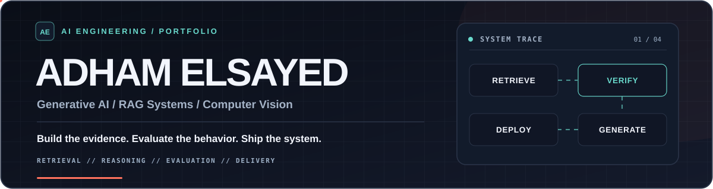
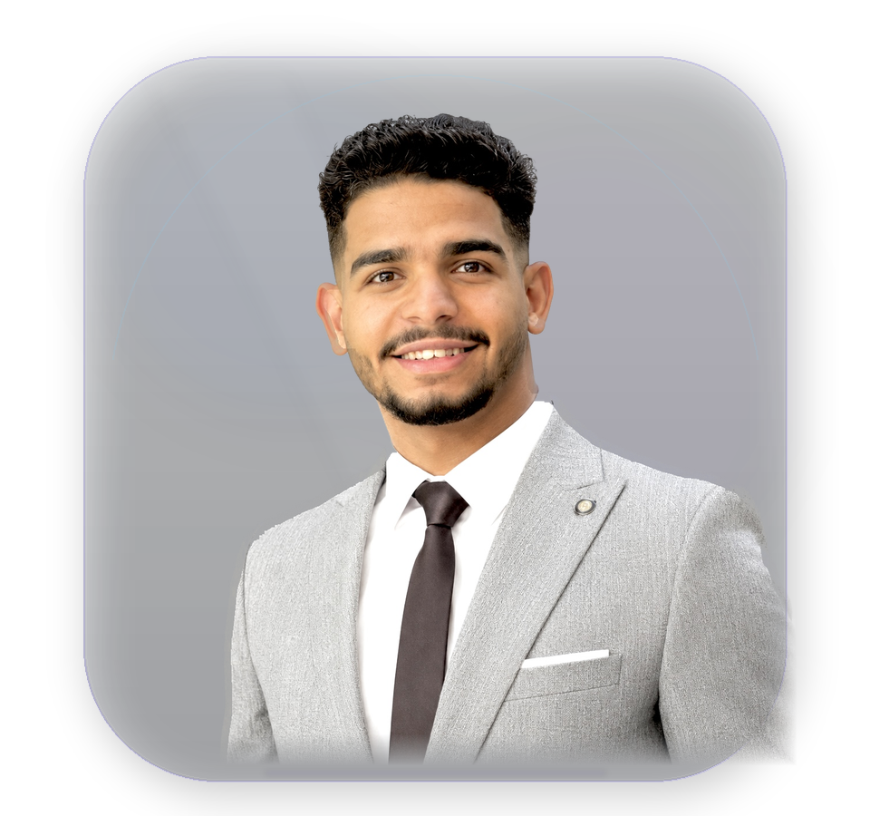

<div align="center">

<picture>
  <source media="(max-width: 640px) and (prefers-color-scheme: dark)" srcset="./assets/profile-header-mobile-dark.svg" />
  <source media="(max-width: 640px) and (prefers-color-scheme: light)" srcset="./assets/profile-header-mobile-light.svg" />
  <source media="(prefers-color-scheme: dark)" srcset="./assets/profile-header-dark.svg" />
  <source media="(prefers-color-scheme: light)" srcset="./assets/profile-header-light.svg" />
  
</picture>

<br />



### AI Engineer · Generative AI · RAG · Computer Vision

*I turn AI research into systems that retrieve evidence, evaluate their behavior, and work beyond a notebook.*

<p>
  <a href="https://adhamelsayedai.github.io/"></a>
  <a href="https://adhamelsayedai.github.io/Adham_Elsayed_CV.pdf"></a>
  <a href="https://www.linkedin.com/in/adham-elsayed-/"></a>
</p>

</div>

## 01 / About

I'm an **AI Engineering student at Mansoura University**, focused on the intersection of **LLM applications, trustworthy retrieval, computer vision, and backend engineering**.

I care about the parts of AI that matter after the demo: evaluating retrieval, validating evidence, designing safe fallback behavior, connecting models to APIs, and making the result usable in a real product.

<blockquote>
<strong>Engineering principle</strong> — A confident answer is not the same as a grounded one. A working model is not the same as a validated system.
</blockquote>

## 02 / What I build

<table>
  <tr>
    <td width="33%" valign="top">
      <h3>Grounded AI</h3>
      <p>Hybrid search, embeddings, reranking, evidence gates, citation-aware generation, and abstention.</p>
      <sub>RAG · Evaluation · GenAI</sub>
    </td>
    <td width="33%" valign="top">
      <h3>Vision &amp; Edge AI</h3>
      <p>Object classification/detection, camera pipelines, inference optimization, and edge-device integration.</p>
      <sub>PyTorch · YOLO · OpenCV · ONNX</sub>
    </td>
    <td width="33%" valign="top">
      <h3>AI Product Engineering</h3>
      <p>Python services, REST APIs, database-backed workflows, testing, and frontend integration.</p>
      <sub>FastAPI · SQL · React · Git</sub>
    </td>
  </tr>
</table>

## 03 / Selected work

*The portfolio has the visuals. Here are the engineering stories and source links.*

<table>
<tr>
<td valign="top" width="50%">

**[MedFlow — Clinical RAG](https://adhamelsayedai.github.io/#projects)**

Evidence-grounded medical AI prototype combining hybrid retrieval, source resolution, claim checks and bounded answer states.

**Focus:** Retrieval quality, citation validation, safety-aware generation.

<sub>Python · Hybrid RAG · FastAPI · Evaluation</sub>

</td>
<td valign="top" width="50%">

**[AttendanceOS — Smart Attendance](https://github.com/AdhamElsayedAI/Smart-Attendance-System)**

Exam-scoped university attendance with an operator workspace, face recognition, blink checks, and SQLite recording.

**Focus:** Computer vision, React/FastAPI integration and supervised workflows.

<sub>React · TypeScript · FastAPI · OpenCV · dlib</sub>

</td>
</tr>
<tr>
<td valign="top">

**[Smart Basket — Edge AI](https://github.com/AdhamElsayedAI/Smart-Basket)**

Camera-based grocery detection with ONNX inference, Raspberry Pi integration and optional real-time basket-state sync.

**Focus:** Inference deployment and connecting predictions to application state.

<sub>YOLO · ONNX Runtime · Raspberry Pi · Firebase</sub>

</td>
<td valign="top">

**[Code AI Proctor — Exam Platform](https://github.com/AdhamElsayedAI/code-ai-proctor)**

Online quiz workflows, webcam-frame classification alerts, teacher review and PDF-informed Gemini study assistance.

**Focus:** AI services, assessment workflows and responsible human review.

<sub>PyTorch · YOLO · FastAPI · SQLAlchemy · Gemini</sub>

</td>
</tr>
</table>

<details>
<summary><strong>Engineering evidence and evaluation scope</strong></summary>

<br />

For MedFlow, internal evaluation reported **87.50% Hit@4** and **0.7031 MRR** on **16 retrieval questions**; a separate **seven-case** grounded generation check reported valid citation IDs on all seven cases. These are **small engineering evaluations, not clinical-accuracy claims**.

Other projects should not be judged by unverified production accuracy or latency numbers. Hardware-dependent recognition, product counting and exam-proctoring classification need task-specific validation in their real operating environments.

</details>

## 04 / Technology toolkit

<div align="center">

**Languages & Backend**


**Machine Learning & Vision**


**Retrieval, Infrastructure & Integration**


</div>

## 05 / How I work

```text
PROBLEM + CONSTRAINTS
        │
        ▼
DATA + EVIDENCE → BASELINE MODEL → EVALUATION
                                      │
                            ┌─────────┴─────────┐
                            ▼                   ▼
                      FAILURE ANALYSIS    GROUNDING CHECKS
                            └─────────┬─────────┘
                                      ▼
                                 API + PRODUCT
                                      │
                                      ▼
                                TEST → ITERATE
```

I prefer measurable improvements over arbitrary scores, source-grounded answers over polished guesses, and useful production paths over impressive demos without verification.

---

<div align="center">

### Interested in building something meaningful?

[**Explore my portfolio ↗**](https://adhamelsayedai.github.io/) &nbsp; · &nbsp; [**Read my résumé ↗**](https://adhamelsayedai.github.io/Adham_Elsayed_CV.pdf) &nbsp; · &nbsp; [**Get in touch ↗**](mailto:adhamelsayed515@gmail.com)

<sub>Adham Elsayed · AI Engineer · Egypt</sub>

</div>
