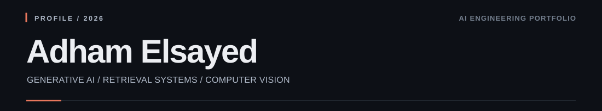

<picture>
  <source media="(max-width: 640px) and (prefers-color-scheme: light)" srcset="./assets/profile-editorial-mobile-light.svg" />
  <source media="(max-width: 640px) and (prefers-color-scheme: dark)" srcset="./assets/profile-editorial-mobile-dark.svg" />
  <source media="(prefers-color-scheme: light)" srcset="./assets/profile-editorial-light.svg" />
  
</picture>

**AI Engineer · Generative AI · RAG · Computer Vision**

Building applied AI systems across evidence-grounded retrieval, model evaluation, computer vision, and backend engineering.

[Portfolio](https://adhamelsayedai.github.io/) &nbsp;·&nbsp; [Résumé](https://adhamelsayedai.github.io/Adham_Elsayed_CV.pdf) &nbsp;·&nbsp; [LinkedIn](https://www.linkedin.com/in/adham-elsayed-/) &nbsp;·&nbsp; [Email](mailto:adhamelsayed515@gmail.com)

## About

I'm an **AI Engineering student at Mansoura University**, interested in the engineering required to make models useful: building retrieval pipelines, checking whether answers are supported, connecting models to APIs, and evaluating what fails.

My main areas of work are **Generative AI and RAG**, **computer vision and edge inference**, and **Python backend development**.

## Selected projects

| Project | What I built | Stack |
| :--- | :--- | :--- |
| **[MedFlow](https://adhamelsayedai.github.io/#projects)** | Evidence-grounded clinical RAG prototype with retrieval evaluation, citation checks, and bounded responses. Team project; my focus is retrieval and grounding. | Python, hybrid retrieval, FastAPI |
| **[AttendanceOS](https://github.com/AdhamElsayedAI/Smart-Attendance-System)** | Exam-scoped university attendance prototype combining face recognition, blink verification, an operator dashboard, and SQLite records. | React, TypeScript, FastAPI, OpenCV |
| **[Smart Basket](https://github.com/AdhamElsayedAI/Smart-Basket)** | Camera-based grocery detection, ONNX edge inference, and optional Firebase basket-state synchronization. | YOLO, ONNX, Raspberry Pi, Firebase |
| **[Code AI Proctor](https://github.com/AdhamElsayedAI/code-ai-proctor)** | Online quiz platform with webcam-classification alerts for teacher review and Gemini-powered study support. | PyTorch, FastAPI, SQLAlchemy, Gemini |

<strong>Evaluation notes</strong>

MedFlow's internal retrieval benchmark reported **Hit@4 of 87.50%** and **MRR of 0.7031** over 16 questions. A separate seven-case evaluation reported valid citation IDs in all seven cases. These are limited engineering evaluations, not clinical-accuracy measurements.

The other prototypes require further hardware and task-specific evaluation before any production-performance claims.

## Technical focus

| Area | Technologies and methods |
| :--- | :--- |
| **LLM & retrieval engineering** | RAG, embeddings, BM25, hybrid search, reranking, citation evaluation, grounded generation |
| **Machine learning & vision** | Python, PyTorch, YOLO, OpenCV, NumPy, ONNX Runtime |
| **Backend & product integration** | FastAPI, REST APIs, SQL, React, TypeScript, Firebase, Docker, Git |

## Engineering approach

I start with a baseline and a measurable evaluation, inspect failure cases, then improve the model or evidence pipeline before integrating it into a product. I keep **demo results**, **internal evaluations**, and **production claims** separate.

---

**[Explore the portfolio](https://adhamelsayedai.github.io/)** &nbsp;·&nbsp; **[View my CV](https://adhamelsayedai.github.io/Adham_Elsayed_CV.pdf)** &nbsp;·&nbsp; **[Get in touch](mailto:adhamelsayed515@gmail.com)**

