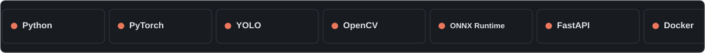

  <picture>
    <source media="(max-width: 640px) and (prefers-color-scheme: dark)" srcset="./assets/hero-mobile-dark.svg" />
    <source media="(max-width: 640px) and (prefers-color-scheme: light)" srcset="./assets/hero-mobile-light.svg" />
    <source media="(prefers-color-scheme: dark)" srcset="./assets/hero-dark.svg" />
    <source media="(prefers-color-scheme: light)" srcset="./assets/hero-light.svg" />
    
  </picture>

 

I’m **Adham Elsayed**, an AI Engineering student at **Mansoura University, Egypt**. I work on **generative AI, retrieval-augmented systems, computer vision, and the backend services that turn models into usable software**.

My focus is on the parts that make AI systems trustworthy in practice: the quality of the data, the evidence behind an answer, how a model is evaluated, and how the result reaches a product.

**[Portfolio ↗](https://adhamelsayedai.github.io/)** &nbsp;·&nbsp; **[Résumé ↗](https://adhamelsayedai.github.io/Adham_Elsayed_CV.pdf)** &nbsp;·&nbsp; **[LinkedIn ↗](https://www.linkedin.com/in/adham-elsayed-/)** &nbsp;·&nbsp; **[Email ↗](mailto:adhamelsayed515@gmail.com)**

<picture>
  <source media="(prefers-color-scheme: dark)" srcset="./assets/divider-dark.svg" />
  <source media="(prefers-color-scheme: light)" srcset="./assets/divider-light.svg" />
  
</picture>

### What I work on

**01 &nbsp; Grounded AI & RAG**  
Hybrid search, embeddings, reranking, evidence selection, citation grounding, and retrieval evaluation.

**02 &nbsp; Computer Vision & Edge AI**  
Detection and classification pipelines, OpenCV, ONNX inference, and deployment-oriented experiments.

**03 &nbsp; Backend engineering**  
Python and FastAPI services, data modeling, API integration, testing, and practical interfaces.

### Selected engineering work

**[MedFlow ↗](https://adhamelsayedai.github.io/#projects)** · Clinical retrieval & grounded answers  
A clinical learning prototype focused on finding supporting evidence before generating an answer. My work centered on retrieval behavior, evaluation, and citation grounding. *Portfolio case study; repository source is private.*

**[AttendanceOS ↗](https://github.com/AdhamElsayedAI/Smart-Attendance-System)** · Computer vision & university software  
A local-first attendance prototype combining exam rosters, face recognition, blink verification, a React operator interface, and a FastAPI backend.

**[Smart Basket ↗](https://github.com/AdhamElsayedAI/Smart-Basket)** · Edge AI  
Grocery-item detection and basket tracking with YOLO, ONNX Runtime, Raspberry Pi integration, and optional Firebase synchronization.

**[Code AI Proctor ↗](https://github.com/AdhamElsayedAI/code-ai-proctor)** · Assessment technology  
An educational assessment prototype connecting computer-vision risk signals, instructor review, and course-grounded AI explanations. Alerts are prompts for human review, not proof of misconduct.

### Tools I use

<picture>
  <source media="(prefers-color-scheme: dark)" srcset="./assets/stack-dark.svg" />
  <source media="(prefers-color-scheme: light)" srcset="./assets/stack-light.svg" />
  
</picture>

**AI / Retrieval** &nbsp; Python · PyTorch · YOLO · OpenCV · ONNX Runtime · BM25 · Embeddings · RAG evaluation

**Backend / Product** &nbsp; FastAPI · SQL · Docker · React · TypeScript · Git · Firebase

<picture>
  <source media="(prefers-color-scheme: dark)" srcset="./assets/divider-dark.svg" />
  <source media="(prefers-color-scheme: light)" srcset="./assets/divider-light.svg" />
  
</picture>

I’m especially interested in **AI systems that can be measured, explained, and maintained** — not just demonstrated.

**Have an idea to collaborate on?** [Get in touch](mailto:adhamelsayed515@gmail.com).
